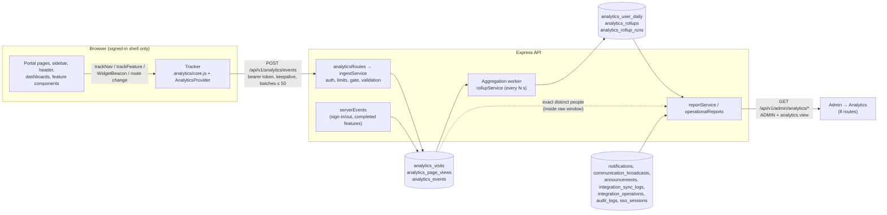
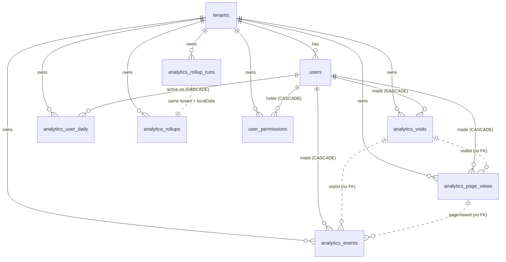

# EdunexusAI Admin Analytics — Technical Documentation

The engineering reference for portal usage analytics (Administration → Analytics). It describes the code as it exists
on branch `feature/admin-analytics` (uncommitted, not released) as of 2026-11-12. Every table, column, endpoint and
formula below was taken from the source; file references are repository-relative (`edunexus/…` omitted) with the line
where the function starts. Where behaviour is inferred rather than read directly, it says so.

Companion document: `docs/portal-analytics.md` (shorter design and rollout notes). If the two disagree, this one and
the code win.

---

## Contents

1. [Architecture](#1-architecture)
2. [Feature reference](#2-feature-reference)
3. [Device analytics in detail](#3-device-analytics-in-detail)
4. [Database reference](#4-database-reference)
5. [Event catalogue](#5-event-catalogue)
6. [API reference](#6-api-reference)
7. [Metric definitions](#7-metric-definitions)
8. [Security, privacy and permissions](#8-security-privacy-and-permissions)
9. [Environment, deployment and operations](#9-environment-deployment-and-operations)
10. [Limitations and known inaccuracies](#10-limitations-and-known-inaccuracies)
11. [Production readiness](#11-production-readiness)
12. [Tracing a metric end to end](#12-tracing-a-metric-end-to-end)

---

## 1. Architecture

### 1.1 Components

| Layer | Code | Responsibility |
|---|---|---|
| Catalogue | `shared/analyticsCatalog.js` | The fixed list of page keys (83 keys over 86 route patterns), navigation sources and targets, 33 widgets, 19 features, enums, and `resolveContextRole()`. Imported by both the API and the browser. |
| Browser tracker | `frontend/src/analytics/core.js` (pure logic), `AnalyticsProvider.jsx` (lifecycle, transport), `index.js` (public helpers), `WidgetBeacon.jsx` (widgets) | Visits, page views, visible time, navigation, widget and feature events; batching, retry, spool. |
| Ingestion | `backend/src/modules/analytics/analyticsRoutes.js`, `ingestService.js` (`ingest` line 51) | Authenticate, rate-limit, gate, validate, derive identity, upsert raw rows. |
| Server events | `backend/src/modules/analytics/serverEvents.js` | Sign-in, sign-out and completed features written by the API itself. |
| Aggregation | `backend/src/modules/analytics/rollupService.js` (`rebuildDay` line 85, `startAnalyticsWorker` line 244) | Raw rows → person-day rows and daily facts; retention. |
| Reports | `backend/src/modules/analytics/reportService.js`, `operationalReports.js` | Usage reports (from analytics tables); communication and integration reports (from existing portal tables). |
| Access | `backend/src/modules/analytics/accessService.js`, `adminAnalyticsRoutes.js`, `middleware/auth.js` (`requirePermission`) | `analytics.view` grants, collection switch, report routing. |
| Dashboard | `frontend/src/pages/admin/AdminAnalyticsPage.jsx`, `pages/admin/analytics/*`, `components/analytics/*` | Eight sections, each its own route. |

### 1.2 Data flow



### 1.3 Step by step

1. **Tracking starts** only inside the signed-in layout (`frontend/src/layouts/AppLayout.jsx` renders `<AnalyticsProvider />`) and only when `GET /auth/me` returns `user.analytics.collecting === true` (`backend/src/modules/users/sessionService.js`, `collectingFor`). The login page, `/visit` and `/auth/sso/complete` are never measured.
2. **One tracker per signed-in person** lives in module state in `AnalyticsProvider.jsx` (`session`). It survives a component remount (React StrictMode in development), so one page load is one page view; a real unmount ends it on the next tick.
3. **Route → page key**: `pageKeyForPath(pathname)` (catalogue). The address bar is never read except the `?view=` dashboard tab, which `resolveView()` first reduces to one of the account's own views.
4. **Events are queued** with a browser UUID and timestamp; batches are sent at 20 queued events, on the 60-second heartbeat, when the tab is hidden, on `pagehide`, and before sign-out (`AuthContext.logout` → `flushAnalytics()`).
5. **Ingestion** (`analyticsRoutes.js` line 33): per-address limiter → `requireAuth` → per-account limiter → collection gate (`isCollecting`) → envelope validation → `ingest()`. Identity, institution, roles and the page's workspace come from the server.
6. **Raw storage**: one upsert for the visit, one upsert per page view, one `createMany(skipDuplicates)` for discrete events.
7. **Aggregation**: the worker rebuilds each institution-local day by replacement into `analytics_user_daily` and `analytics_rollups`, and records the run in `analytics_rollup_runs`.
8. **Reports** read person-day rows and facts, plus raw rows inside the 90-day window for exact distinct people per page/feature/widget, and return exact counts (no person ids) to administrators holding `analytics.view`.

---

## 2. Feature reference

Conventions for every entry: *Range* = selected `from`–`to` in the institution's local calendar (`tenants.timezone`,
UTC when empty or invalid); *role filter* = people **holding** the role at the time of the activity
(`rolesHeld @> ARRAY[role]` or the rollup `role` column); *device filter* = rollup `device` column, raw `deviceClass`,
or person-day `devices` array.

### 2.1 Overview — `/admin/analytics`

Component `frontend/src/pages/admin/analytics/OverviewTab.jsx`; endpoint `GET /api/v1/admin/analytics/overview`;
service `overviewReport()` (`reportService.js` line 173). Two KPI groups (Audience, Engagement), a daily trend,
most-visited pages, most-used features, device share and plain-language observations. Its sub-metrics are 2.2–2.10.

### 2.2 Active users

- **Measures**: distinct people active in the range. Active = at least one page view, `nav.click`, `widget.interact` or `feature.use` on that day.
- **Why useful**: the headline audience for the chosen period, each person counted once regardless of roles.
- **Origin**: page views (browser tracker, route changes), discrete events (browser) and completed features (server).
- **Tables**: `analytics_user_daily` (`tenantId`, `localDate`, `userId`, `rolesHeld`, `devices`), built from `analytics_page_views` and `analytics_events`.
- **Formula**: `COUNT(DISTINCT "userId") FROM analytics_user_daily WHERE tenant AND "localDate" BETWEEN from AND to [AND role/device filter]` (`periodTotals`, line 96).
- **Context line**: returning users (below).
- **Limitations**: sign-in alone, widget impressions and background polling never count; a person active only through a server-side feature (no page view that day) still counts.

### 2.3 Average daily active users

- **Measures**: the number of people active on a typical measured day.
- **Formula** (`periodTotals`): `person-days ÷ measured days`, where person-days = rows in `analytics_user_daily` for the range (one row per person per active local day) and measured days = days from `max(from, local date collection started)` to `to` (`measuredDays`, line 90). `null` when no day of the range was measured.
- **Inactive days**: measured days with nobody active are included in the denominator (they count as 0).
- **Days before collection began**: excluded from the denominator. They were not measured, so they are not inactive days.
- **Partial day**: today is included (it can only grow).
- **Timezone**: days are institution-local (`localDateOf`).
- **Changed 2026-11-12**: previously the denominator was every day of the range, so a 30-day range with one measured day showed 3 people as `0.1`. The stickiness calculation already used measured days; both now agree.
- **Context line**: `personDays over measuredDays` (`basis` in the response).

### 2.4 Weekly / monthly active users

- **Formula** (`trailingUsers`, line 129): `COUNT(DISTINCT "userId")` over the 7 / 30 local days ending at `to`, from `analytics_user_daily`, with role/device filters. Counted person by person (never by adding daily counts).
- **Stickiness** (Monthly card context): `averageDailyOver(ctx, 30) ÷ MAU`, where `averageDailyOver` (line 212) is person-days in those 30 days ÷ measured days in those 30 days.
- **Note**: always anchored on the range's last day, so on the 7-day and 30-day presets they equal Active users by construction.

### 2.5 Page views

- **Measures**: every opening of a portal page. One person opening a page ten times is ten page views; a full reload is a new page view; a re-render or query-string change on the same page is not.
- **Origin**: `AnalyticsProvider` route effect → `tracker.setPage(key, view)` → `page.view` event (sent when the page is first visible).
- **Tables**: `analytics_page_views` (one row per page view, id = browser UUID); aggregated as `analytics_user_daily.pageViews` and rollup fact `PAGE`.
- **Formula**: Overview `SUM("pageViews") FROM analytics_user_daily` for the range; Pages report `SUM(count) FROM analytics_rollups WHERE fact='PAGE' AND role/device = filter or 'ALL'`. Both equal the number of `analytics_page_views` rows whose `startedAt` falls in the range (verified 2026-11-12: 100 = 100).
- **Duplicates**: a repeated or retried page view is stored once (upsert by id). React StrictMode duplicates (development only) were possible before 2026-11-12; see §10.

### 2.6 Unique page visitors

- **Measures**: distinct people who opened at least one page.
- **Formula**: Overview `COUNT(DISTINCT "userId") FILTER (WHERE "pageViews" > 0) FROM analytics_user_daily` (`pageVisitors`). Per page (Pages table, page drill-down): `COUNT(DISTINCT "userId") FROM analytics_page_views WHERE tenant AND "startedAt" in range [AND filters] GROUP BY "pageKey"` (`rangeUsers`, line 161) — exact while the range lies inside the raw window; beyond it, the busiest single day's `uniqueUsers` (response flag `meta.uniquesExact = false`).
- **Distinction**: page views count openings; unique visitors count people. *Page views per visitor* = page views ÷ unique visitors (computed in the UI from the two API values).

### 2.7 Visits

- **Measures**: browser visits — continuous use with no gap longer than 30 minutes (`VISIT_IDLE_MS`), shared by all tabs of one browser through `localStorage` key `edunexus.analytics.visit`. **Not** a sign-in session: one `sso_sessions` row or refresh-token chain covers many visits.
- **Tables**: `analytics_visits` (one row per visit); rollup facts `VISIT` (count, duration) and `VISIT_DURATION` (buckets).
- **Formula**: `SUM(count) FROM analytics_rollups WHERE fact='VISIT'`. A visit belongs to the local day it started.
- **Visit length**: `SUM("durationMs") ÷ SUM("durationSamples")` of `VISIT`, where each visit's duration is `LEAST(lastSeenAt − startedAt, 12 h)`.
- **Pages per visit**: page views ÷ visits (`pageViewsPerVisit`).

### 2.8 Average time on page

- **Measures**: visible, active time per page view.
- **Collection** (`core.js`): time accrues only while `document.visibilityState === 'visible'` and the last input (pointer, key, scroll, touch, wheel — no detail kept) was within 5 minutes; a timer gap larger than two ticks (sleep) adds nothing. `page.ping` every 60 s and `page.exit` carry the cumulative `visibleMs`.
- **Server caps** (`ingest`): `visibleMs ≤ 4 h`, and never more than the page view's elapsed time + 5 s; the stored value only grows (`GREATEST`).
- **Formula**: rollup `PAGE`: `SUM(LEAST(visibleMs, 4h) for views with visibleMs ≥ 1000) ÷ COUNT(views with visibleMs ≥ 1000)`. Views under one second are excluded from both numerator and denominator.
- **Limitation**: the final seconds after the last heartbeat are lost if the tab closes without `pagehide` delivery.

### 2.9 Returning users

- **Formula**: people with ≥ 2 rows in `analytics_user_daily` within the range ÷ active users (`returningUsers`, `returningRate`). Shown as the Active users context line and as an observation.

### 2.10 Previous-period comparison (trend chips)

- `withChange(current, previous)` → `change = (current − previous) ÷ previous`, only when `previousComparable` = the previous period (same length, immediately before) starts on or after the local date collection started, and `previous` is non-zero. Otherwise no chip is drawn — never an invented one.

### 2.11 People & activity — `/admin/analytics/people`

Component `ActivityTab.jsx`; endpoint `/activity`; service `activityReport()` (line 219).

| Element | Source and formula |
|---|---|
| Daily active people | `dailySeries`: per local day `COUNT(*) FROM analytics_user_daily` (one row = one person-day); days before collection are gaps. |
| Weekly / monthly (rolling) | For each day d: distinct users in [d−6, d] and [d−29, d]; days before collection → `null` (gap), not 0. |
| Activity by role | For each role: `accounts` = **current** active, non-excluded accounts holding the role (`users` ⋈ `user_roles`); other columns from `periodTotals` with the role filter. Rows overlap for multi-role people. |
| Where the portal is used | Rollup fact `CONTEXT` (`subjectKey` = `contextRole` of each page view; role column `ALL`). Additive: each page view has one workspace. |
| Peak hours | Rollup fact `HOUR` (`subjectKey` '00'–'23', institution-local hour of page views and qualifying events). Cell = Σ daily `uniqueUsers` for that weekday/hour ÷ number of that weekday in the measured part of the range. |
| Busiest weekdays | Mean of daily active people per weekday over measured days. |
| How people sign in | Rollup fact `AUTH` from `auth.sign_in` events (`action` = `SSO` / `PASSWORD`). |

### 2.12 Pages & navigation — `/admin/analytics/pages`

Component `PagesTab.jsx`; endpoints `/pages`, `/pages/:pageKey`, `/navigation`; services `pagesReport` (294), `pageDetailReport` (326), `navigationReport` (356).

- **Pages**: every catalogue page (filtered to pages the selected role can open) with `views` (fact `PAGE`), `users` (2.6), `averageVisibleMs`, `share` (views ÷ total), `previousViews`; `sections` groups by catalogue section with unused counts. Drill-down: daily `PAGE` series for the key, split by role held and by device.
- **Navigation**: `nav.click` events. Destinations = fact `NAV` (subject = target page key or external `app.*` key); people = raw distinct per target; sources = fact `NAV_SOURCE` (`SIDEBAR`, `SIDEBAR_FLYOUT`, `BREADCRUMB`, `HEADER_MENU`, `SEARCH`). Links inside page content are not navigation clicks.
- **Origin**: `Sidebar.jsx` lines 159, 253, 461 (and 407 for external systems), `Breadcrumbs.jsx` 85/108, `Header.jsx` 173–174 (search) and 490–507 (profile menu).

### 2.13 Features & widgets — `/admin/analytics/features`

Component `EngagementTab.jsx`; endpoints `/features`, `/widgets`; services `featuresReport` (380), `widgetsReport` (405).

- **Features**: rollup fact `FEATURE` (`subjectKey` = feature key). `uses` = Σ count; `users` = raw distinct `feature.use` per key; `adoptionRate` = users ÷ active users in the range; `usesPerUser`. The device filter is ignored (server-side events carry no device). "Opened vs used" groups the catalogue's `OPEN` and `COMPLETE` actions by feature group; a group's people = its busiest action of that stage.
- **Widgets**: impressions = fact `WIDGET_IMPRESSION`, built with `DISTINCT ON ("pageViewId", "subjectKey")` so a widget seen twice in one page view counts once; viewers = raw distinct `widget.impression`; interactors = raw distinct `widget.interact`; `engagementRate` = interactors ÷ viewers.

### 2.14 Devices & visits — `/admin/analytics/devices`

See §3. Endpoint `/devices`, service `devicesReport` (425).

### 2.15 Communication — `/admin/analytics/communication` (existing records, no tracking)

Component `CommunicationTab.jsx`; endpoint `/communication`; service `communicationReport()` (`operationalReports.js` line 18). **Works without collection**: it reads the portal's own notification tables.

| Element | Tables and formula |
|---|---|
| Sent / read / unread | `notifications` with `createdAt` in the range (local days): `COUNT(*)`, `COUNT(*) FILTER (WHERE "isRead")`, difference. |
| Recipients | `COUNT(DISTINCT "userId")`. |
| Time to read | `AVG("readAt" − "createdAt")` for read rows; read within a day = share with `readAt − createdAt ≤ 24 h`. |
| By kind / category | `GROUP BY "sourceType"` / `"category"`. |
| By audience (role) | Join `user_roles`/`roles`: recipients **currently** holding each role (not the role at send time). |
| Broadcasts | `communication_broadcasts` `status='SENT'`, `sentAt` in range; recipients = `recipientCount`; read = notifications with `sourceType='BROADCAST'`, `sourceRefId` = broadcast id, `isRead`. Grouped by `audienceType`. |
| Course announcements | `announcements` (`postedAt` in range) and `announcement_reads`. |

Not available and not reported: email/SMS delivery receipts and acknowledgement (`capabilities: { channel: 'IN_APP', deliveryReceipts: false, acknowledgement: false }`). Role filter = recipient role; no device filter.

### 2.16 Integrations — `/admin/analytics/integrations` (existing records, no tracking)

Service `integrationsReport()` (`operationalReports.js` line 91).

- Per integration (`integrations`): current `status`, `lastAttemptAt`, `lastSuccessfulSyncAt`, `lastResponseTimeMs`, `lastErrorMessage`.
- In range (`integration_sync_logs.startedAt`): runs, `SUCCESS`/`FAILED`/`PARTIAL` counts, success rate, mean `durationMs`, last failure, failure reasons by `outcome`, daily outcomes.
- `integration_operations` (`createdAt` in range) by `status`: succeeded, failed, needs attention (`NEEDS_RECONCILIATION`, `BLOCKED`, `PENDING`).
- University sign-in: `identity_providers` (enabled flag), `audit_logs` actions `SSO_SIGN_IN` / `SSO_REFUSED` in range, open `sso_sessions` (`endedAt IS NULL AND expiresAt > now()`).
- Explicitly not monitored: Strapi CMS availability; uptime of CampusCore, Moodle or the identity provider between sync attempts. Success rate ≠ uptime.

### 2.17 Data health — `/admin/analytics/health`

Service `dataHealthReport()` (`reportService.js` line 493) plus access endpoints.

- Collection switches (platform `ANALYTICS_ENABLED`, institution `tenants.analyticsEnabled`, `analyticsStartedAt`), excluded accounts (`users.analyticsExcludedAt`).
- Freshness: last non-failed run `finishedAt`, aggregation interval, last activity received (`max(analytics_events.receivedAt)` / `max(analytics_page_views.lastSeenAt)`), last-24-hour counts.
- Daily summaries: `analytics_rollup_runs` for the last 14 local days.
- Coverage: share of the last 7 days' page views with `visibleMs ≥ 1000` (shown once ≥ 20 views); catalogue sizes.
- Events refused since the process started (in-memory `rejectionCounters`; reset on restart).
- Retention settings and oldest raw day.
- Collection on/off (`PUT /settings`, needs privacy-notice confirmation) and "Who can open Analytics" (`/access`).

---

## 3. Device analytics in detail

| Question | Answer (from code) |
|---|---|
| Library | None. `classifyDevice()` in `frontend/src/analytics/core.js`. |
| Browser properties used | `window.matchMedia('(pointer: coarse)').matches` and `Math.min(screen.width, screen.height)` (falling back to `innerWidth`/`innerHeight`) — `deviceClass()` in `AnalyticsProvider.jsx`. The user-agent string is never read anywhere in analytics. |
| Rules | coarse pointer **and** shorter screen side < 600 CSS px → `MOBILE`; coarse pointer otherwise → `TABLET`; fine pointer → `DESKTOP` (a narrow desktop window is still `DESKTOP`; an iPad is `TABLET` whatever its user agent claims). |
| Where it runs | In the browser. The server only validates the enum (`z.enum(DEVICE_CLASSES)` on the batch envelope). |
| Unknown devices | There is no unknown class for browser events: every browser falls into one of the three. Server-written events have `deviceClass = NULL`, rolled up as device `'NONE'`. |
| Storage | Per batch envelope, copied onto: the **visit** row (`analytics_visits.deviceClass`, set when the visit row is created and never updated), each **page view** row (set at insert, not updated), each **discrete event** (`analytics_events.deviceClass`). Person-day rows hold the set of devices used that day (`analytics_user_daily.devices`). |
| Statistics | Visits by device: `SUM(count)` of fact `VISIT` per `device` (role column = filter or `ALL`); share = device visits ÷ all visits. People by device: `COUNT(DISTINCT "userId")` over `unnest(devices)` in `analytics_user_daily` (a person on two devices counts under both). Daily trend: fact `VISIT` per day and device. Device mix by role: raw `analytics_visits` × `unnest("rolesHeld")`, only for ranges inside the raw window. Visit-length buckets: fact `VISIT_DURATION`. |
| Effect of the device filter | Usage reports filter by device (rollup `device`, raw `deviceClass`, person-day `devices @> [device]`). Features ignore it (server events have no device); Communication, Integrations and Data health have no device dimension; on Devices & visits the filter is disabled (the section compares devices). |
| Known inconsistency | Because the visit keeps the device it started with while page views/events take each batch's device, switching device mode within one visit (e.g. browser DevTools emulation) can show "0 visits · 1 person" for a device. Observed in development data on 2026-11-12. |

---

## 4. Database reference

Migration: `backend/prisma/migrations/20261111100000_portal_analytics/migration.sql` (additive; rollback statements in its header). Prisma models in `backend/prisma/schema.prisma` (section "Portal usage analytics").

### 4.1 Enums

| Enum | Values |
|---|---|
| `AnalyticsDevice` | `MOBILE`, `TABLET`, `DESKTOP` |
| `AnalyticsRollupStatus` | `PARTIAL`, `FINAL`, `FAILED` |
| `RoleKey` (existing) | `STUDENT`, `FACULTY`, `ADMIN`, `STAFF`, `ALUMNI` |

### 4.2 Columns added to existing tables

| Table (model) | Column | Type | Null | Default | Purpose |
|---|---|---|---|---|---|
| `tenants` (`Tenant`) | `analyticsEnabled` | BOOLEAN | no | `false` | Institution collection switch. |
| `tenants` | `analyticsStartedAt` | TIMESTAMP(3) | yes | — | First time collection was switched on (set once). |
| `users` (`User`) | `analyticsExcludedAt` | TIMESTAMP(3) | yes | — | Account never measured (test/service accounts). No UI sets it; database or script only. |

### 4.3 `analytics_visits` (`AnalyticsVisit`) — raw, ~90 days

| Column | PostgreSQL type | Null | Notes |
|---|---|---|---|
| `id` | UUID | no | **PK**. Browser-generated visit id. |
| `tenantId` | TEXT | no | FK → `tenants.id` (CASCADE). From the session. |
| `userId` | TEXT | no | FK → `users.id` (CASCADE). From the session. |
| `rolesHeld` | "RoleKey"[] | yes | Roles held when the row was created. |
| `authMethod` | VARCHAR(12) | no | CHECK `IN ('PASSWORD','SSO')`, from the token (`amr`). |
| `deviceClass` | "AnalyticsDevice" | no | First batch's device. |
| `entryPageKey` | VARCHAR(64) | yes | First `page.view` key of the first batch. |
| `startedAt` | TIMESTAMP(3) | no | Corrected browser time. |
| `lastSeenAt` | TIMESTAMP(3) | no | `GREATEST` of event times. |

Indexes: `(tenantId, startedAt)`, `(userId, startedAt)`. No created/updated columns (`startedAt`/`lastSeenAt` serve).

### 4.4 `analytics_page_views` (`AnalyticsPageView`) — raw, ~90 days

| Column | Type | Null | Notes |
|---|---|---|---|
| `id` | UUID | no | **PK**. Browser page-view id. |
| `tenantId` | TEXT | no | FK → `tenants` (CASCADE). |
| `userId` | TEXT | no | FK → `users` (CASCADE). |
| `visitId` | UUID | no | The visit id. **No foreign key** to `analytics_visits` (the visit row is written first in the same request, but nothing enforces it). |
| `pageKey` | VARCHAR(64) | no | Catalogue key. |
| `rolesHeld` | "RoleKey"[] | yes | |
| `contextRole` | VARCHAR(12) | no | CHECK role or `SHARED`; `resolveContextRole()`. |
| `deviceClass` | "AnalyticsDevice" | no | |
| `startedAt` | TIMESTAMP(3) | no | View time, or `at − visibleMs` if the view event was lost. |
| `lastSeenAt` | TIMESTAMP(3) | no | |
| `visibleMs` | INTEGER | no | Default 0; CHECK ≥ 0; cumulative, capped. |

Indexes: `(tenantId, startedAt)`, `(tenantId, pageKey, startedAt)`, `(userId, startedAt)`, `(visitId)`.

### 4.5 `analytics_events` (`AnalyticsEvent`) — raw, append-only, ~90 days

| Column | Type | Null | Notes |
|---|---|---|---|
| `id` | UUID | no | **PK**. Browser `eventId`, or `crypto.randomUUID()` for server events. |
| `tenantId` | TEXT | no | FK → `tenants` (CASCADE). |
| `userId` | TEXT | no | FK → `users` (CASCADE). |
| `visitId` | UUID | yes | Null for server events. No FK. |
| `pageViewId` | UUID | yes | Widget events only. No FK. |
| `name` | VARCHAR(32) | no | `nav.click`, `widget.impression`, `widget.interact`, `feature.use`, `auth.sign_in`, `auth.sign_out`. |
| `pageKey` | VARCHAR(64) | yes | Page where it happened. |
| `subjectKey` | VARCHAR(64) | yes | Nav target / widget key / feature key. |
| `action` | VARCHAR(32) | yes | Feature action, widget `LINK`/`CONTROL`, sign-in method, sign-out reason. |
| `source` | VARCHAR(24) | yes | Navigation source. |
| `rolesHeld` | "RoleKey"[] | yes | |
| `deviceClass` | "AnalyticsDevice" | yes | Null for server events. |
| `occurredAt` | TIMESTAMP(3) | no | |
| `receivedAt` | TIMESTAMP(3) | no | Default `CURRENT_TIMESTAMP`. |

Indexes: `(tenantId, occurredAt)`, `(tenantId, name, occurredAt)`, `(userId, occurredAt)`.

### 4.6 `analytics_user_daily` (`AnalyticsUserDaily`) — per-person aggregate, 400 days

| Column | Type | Null | Notes |
|---|---|---|---|
| `tenantId` | TEXT | no | **PK part**; FK → `tenants` (CASCADE). |
| `localDate` | DATE | no | **PK part**; institution-local day. |
| `userId` | TEXT | no | **PK part**; FK → `users` (CASCADE). |
| `rolesHeld` | "RoleKey"[] | yes | Union of roles on that day's raw rows. |
| `devices` | "AnalyticsDevice"[] | yes | Distinct devices that day. |
| `visits` | INTEGER | no | Distinct non-null `visitId`s. |
| `pageViews` | INTEGER | no | Page views started that day. |
| `visibleMs` | INTEGER | no | Σ LEAST(visibleMs, 4 h), capped at 24 h. |

Index: `(userId)`. A row exists only for a day the person was active. Counts only — no page detail.

### 4.7 `analytics_rollups` (`AnalyticsRollup`) — institution aggregate, 1,100 days

| Column | Type | Null | Notes |
|---|---|---|---|
| `tenantId` | TEXT | no | PK part; FK → `tenants` (CASCADE). |
| `localDate` | DATE | no | PK part. |
| `fact` | VARCHAR(24) | no | PK part: `PAGE`, `CONTEXT`, `NAV`, `NAV_SOURCE`, `WIDGET_IMPRESSION`, `WIDGET_INTERACTION`, `FEATURE`, `AUTH`, `HOUR`, `VISIT`, `VISIT_DURATION`. |
| `subjectKey` | VARCHAR(64) | no | PK part: page/target/widget/feature key, context role, hour `00`–`23`, duration bucket (`under-1m`, `1-5m`, `5-15m`, `15-30m`, `30-60m`, `over-60m`), sign-in method, or `all`. |
| `role` | VARCHAR(12) | no | PK part: role held, or `ALL` (each person once). |
| `device` | VARCHAR(12) | no | PK part: device, `NONE` (server events), or `ALL`. |
| `count` | INTEGER | no | Rows in the group. |
| `uniqueUsers` | INTEGER | no | Distinct people **on that day only**. |
| `durationMs` | BIGINT | no | Σ duration (PAGE: visible time of views ≥ 1 s; VISIT: capped visit length). |
| `durationSamples` | INTEGER | no | Number of durations summed. |

Index: `(tenantId, fact, localDate)`. No person ids.

### 4.8 `analytics_rollup_runs` (`AnalyticsRollupRun`) — operational, 1,100 days

`tenantId` TEXT (PK part, FK CASCADE), `localDate` DATE (PK part), `status` "AnalyticsRollupStatus" not null, `startedAt` TIMESTAMP(3) not null, `finishedAt` TIMESTAMP(3) null, `durationMs` INTEGER null, `errorCode` VARCHAR(60) null.

### 4.9 `user_permissions` (`UserPermission`) — access control

`id` TEXT PK (`uuid()`), `tenantId` TEXT FK CASCADE, `userId` TEXT FK CASCADE, `permission` TEXT (CHECK `IN ('analytics.view')`), `grantedByUserId` TEXT null (no FK; null when granted by script), `createdAt` TIMESTAMP(3) default now. Unique `(userId, permission)`; index `(tenantId, permission)`.

### 4.10 Relationships



Deleting an account deletes its raw and person-day rows (CASCADE); institution aggregates keep no person ids and are unaffected. Deleting a tenant deletes everything above.

### 4.11 Example SQL (placeholders `:tenant`, `:tz`, `:from`, `:to`; dates are `YYYY-MM-DD`)

```sql
-- Active users and average daily active users for a range (person-day table).
-- measured_days = days from GREATEST(:from, local date of tenants."analyticsStartedAt") to :to.
SELECT count(DISTINCT "userId") AS active_users,
       count(*)                 AS person_days
FROM analytics_user_daily
WHERE "tenantId" = :tenant AND "localDate" BETWEEN :from::date AND :to::date;
-- average_daily_active_users = person_days / measured_days

-- Weekly / monthly active users ending :to.
SELECT count(DISTINCT "userId") FILTER (WHERE "localDate" > :to::date - 7)  AS wau,
       count(DISTINCT "userId") FILTER (WHERE "localDate" > :to::date - 30) AS mau
FROM analytics_user_daily
WHERE "tenantId" = :tenant AND "localDate" <= :to::date;

-- Page views versus unique visitors per page, straight from raw rows (institution-local days).
SELECT "pageKey", count(*) AS page_views, count(DISTINCT "userId") AS unique_visitors
FROM analytics_page_views
WHERE "tenantId" = :tenant
  AND (("startedAt" AT TIME ZONE 'UTC') AT TIME ZONE :tz)::date BETWEEN :from::date AND :to::date
GROUP BY "pageKey" ORDER BY page_views DESC;

-- Average time on page (as the PAGE rollup computes it).
SELECT sum(LEAST("visibleMs", 14400000)) FILTER (WHERE "visibleMs" >= 1000)::float8
       / NULLIF(count(*) FILTER (WHERE "visibleMs" >= 1000), 0) AS avg_visible_ms
FROM analytics_page_views WHERE "tenantId" = :tenant;

-- Visits, visit length and device share from the rollups.
SELECT device, sum(count) AS visits, sum("durationMs")::float8 / NULLIF(sum("durationSamples"), 0) AS avg_visit_ms
FROM analytics_rollups
WHERE "tenantId" = :tenant AND fact = 'VISIT' AND role = 'ALL' AND device IN ('MOBILE','TABLET','DESKTOP')
  AND "localDate" BETWEEN :from::date AND :to::date
GROUP BY device;

-- Widget engagement (people who used ÷ people who saw), raw window.
SELECT "subjectKey" AS widget,
       count(DISTINCT "userId") FILTER (WHERE name = 'widget.impression') AS viewers,
       count(DISTINCT "userId") FILTER (WHERE name = 'widget.interact')   AS users_who_interacted
FROM analytics_events
WHERE "tenantId" = :tenant AND name IN ('widget.impression','widget.interact')
GROUP BY "subjectKey";
```

---

## 5. Event catalogue

Browser events are validated by strict Zod schemas in `ingestService.js` (`eventSchema`); an unknown property rejects
that one event. Common fields: `eventId` (UUID, required), `at` (ISO-8601 with offset, required). Server events are
written by `serverEvents.js` only (the browser cannot send them).

| Event | Trigger (source) | Required | Optional | Rules | Destination | Frequency / dedup |
|---|---|---|---|---|---|---|
| `page.view` | First visible moment of a tracked route (`AnalyticsProvider` → `core.setPage`) | `pageViewId` (UUID), `pageKey` (catalogue) | `view` (`student`/`faculty`/`staff`/`alumni`/`admin`/`overview`) | Page must be openable by the account (`resolveContextRole`), else `NOT_PERMITTED`. | `analytics_page_views` (+ visit) | Once per page view; upsert by `pageViewId`. |
| `page.ping` | Every 60 s while visible time grew | `pageViewId`, `pageKey`, `visibleMs` (0–86,400,000) | `view` | Same page key as the stored row. | `analytics_page_views.visibleMs` | Repeated; `GREATEST`, capped. |
| `page.exit` | Route change, tab hidden, `pagehide` | as `page.ping` | `view` | | same | Repeated; idempotent. |
| `nav.click` | Sidebar, flyout, breadcrumb, profile menu, search result | `targetKey` (page key or `app.campuscore*`), `source` (`NAV_SOURCES`) | `pageKey` | | `analytics_events` | Once per click; dedup by `eventId`. |
| `widget.impression` | ≥ 50 % visible for 1 s (`WidgetBeacon`) | `pageViewId`, `pageKey`, `widgetKey` (33 keys) | — | Paused in Studio. | `analytics_events` | Once per widget per page view (client set; rollup `DISTINCT ON`). |
| `widget.interact` | Click on a link/control inside a widget | `pageViewId`, `pageKey`, `widgetKey`, `action` (`LINK`/`CONTROL`) | — | Drag grip ignored. | `analytics_events` | Per click. |
| `feature.use` (browser) | UI feature opened/used (§5.1) | `featureKey` (browser-origin keys only) | `action` (that feature's list), `pageKey` | Action must be in the feature's list (or absent if none). | `analytics_events` | Per use. |
| `feature.use` (server) | After a successful action (§5.1) | — | — | Only when collection applies to that person. | `analytics_events` (`visitId` null) | Per completed action. |
| `auth.sign_in` | `issueSession()` (password and SSO; never on refresh) — `authService.js:126` | — | — | | `analytics_events` (`action` = `PASSWORD`/`SSO`) | Per issued session. |
| `auth.sign_out` | `authController.logout` (`PORTAL`/`PORTAL_LOCAL`) — `authController.js:38`; back-channel logout (`PROVIDER`) — `ssoRoutes.js:172` | — | — | | `analytics_events` | Per sign-out. |

Batch envelope (`envelopeSchema`, strict): `schemaVersion` = 1, `sentAt`, `visitId` (UUID), `visitStartedAt`,
`deviceClass`, `events` (1–50 items). Example (dummy values):

```json
{
  "schemaVersion": 1,
  "sentAt": "2026-11-12T10:15:00.000Z",
  "visitId": "11111111-1111-4111-8111-111111111111",
  "visitStartedAt": "2026-11-12T10:00:00.000Z",
  "deviceClass": "DESKTOP",
  "events": [
    { "name": "page.view", "eventId": "22222222-2222-4222-8222-222222222222", "at": "2026-11-12T10:14:00.000Z",
      "pageViewId": "33333333-3333-4333-8333-333333333333", "pageKey": "academics.grades" },
    { "name": "page.ping", "eventId": "44444444-4444-4444-8444-444444444444", "at": "2026-11-12T10:15:00.000Z",
      "pageViewId": "33333333-3333-4333-8333-333333333333", "pageKey": "academics.grades", "visibleMs": 58000 },
    { "name": "nav.click", "eventId": "55555555-5555-4555-8555-555555555555", "at": "2026-11-12T10:15:00.000Z",
      "targetKey": "academics.schedule", "source": "SIDEBAR", "pageKey": "academics.grades" },
    { "name": "feature.use", "eventId": "66666666-6666-4666-8666-666666666666", "at": "2026-11-12T10:15:00.000Z",
      "featureKey": "chat.opened", "action": "INBOX" }
  ]
}
```

Ingestion rules (`ingest`): time correction `occurredAt = at + (serverNow − sentAt)`; refused if older than 24 h or
more than 60 s in the future (`STALE`). The visit upsert only updates a row owned by the same user and tenant;
otherwise the whole batch is refused (`FOREIGN_ID`). Rejections are counted by reason (`INVALID`, `STALE`,
`NOT_PERMITTED`, `FOREIGN_ID`) in memory; content is never logged. The writes are separate statements, not one
transaction (a failure mid-batch leaves earlier rows; the browser retries and upserts make that safe).

### 5.1 Features (19)

| Key | Origin | Stage | Actions | Emitted at |
|---|---|---|---|---|
| `chat.opened` | browser | OPEN | INBOX, CONVERSATION | `context/ChatContext.jsx:258, 266` |
| `chat.message_sent` | server | COMPLETE | — | `modules/chat/chatService.js:200` (non-duplicate send; REST and socket) |
| `assistant.opened` | browser | OPEN | — | `components/assistant/AssistantLauncher.jsx:138` |
| `assistant.question_asked` | server | COMPLETE | — | `modules/assistant/assistantRoutes.js:36` |
| `notifications.opened` | browser | OPEN | — | `layouts/Header.jsx:418` |
| `notifications.read` | server | COMPLETE | — | `modules/notifications/notificationRoutes.js:40, 49` |
| `search.result_selected` | browser | COMPLETE | PERSON, COURSE, QUICK_NAV, SEE_ALL | `layouts/Header.jsx:173` (no search text) |
| `directory.searched` | browser | COMPLETE | PEOPLE, CAMPUS | `pages/campus/PeopleSearchPage.jsx:51`, `CampusDirectoryPage.jsx:91` (no search text) |
| `moodle.opened` | browser | COMPLETE | COURSE, ASSIGNMENT, ACTIVITY, LOGIN, GRADER | `components/lms/MoodleCoursesPanel.jsx:29, 55, 119`; `pages/faculty/FacultyMoodlePage.jsx:175–215` |
| `campuscore.opened` | browser | COMPLETE | — | `layouts/Sidebar.jsx:407` |
| `requests.submitted` | server | COMPLETE | — | `modules/workflows/workflowRoutes.js:123` |
| `tickets.created` | server | COMPLETE | — | `workflowRoutes.js:145` |
| `forms.submitted` | server | COMPLETE | — | `workflowRoutes.js:167` |
| `advising.booked` | server | COMPLETE | — | `modules/success/successRoutes.js:73` |
| `transcripts.requested` | server | COMPLETE | — | `modules/academics/academicsController.js:82` |
| `calendar.connected` | server | COMPLETE | — | `modules/calendarSync/calendarSyncService.js:77` |
| `dashboard.reordered` | browser | COMPLETE | — | `components/dashboard/SortableDashboard.jsx:112` (after the layout is saved) |
| `pwa.install_prompted` | browser | COMPLETE | — | `layouts/Header.jsx:524` |
| `language.changed` | browser | COMPLETE | — | `i18n/LanguageSelector.jsx:34` |

Widget beacons: `components/dashboard/SortableDashboard.jsx:559` (student and faculty widgets), `pages/admin/AdminDashboardPage.jsx:31/36` (admin sections), `pages/dashboard/CommunityContextDashboard.jsx:105–110` (staff and alumni).

---

## 6. API reference

All responses use the portal envelope `{ success, data, meta? }` / `{ success: false, error: { code, message, details? } }`.

### 6.1 Ingestion

`POST /api/v1/analytics/events` — `analyticsRoutes.js:33`

| | |
|---|---|
| Auth | Bearer access token (`requireAuth`). The tracker never refreshes tokens. |
| Permission | None beyond being signed in; collection must apply to the person. |
| Limits | 64 KB body (`app.js:62`); 6,000 requests/min per client address (before auth); 90 requests/min per account (after auth); excluded from the global API limiter (`rateLimit.js:28`) and from the request log (`app.js:70`). In-memory limiter store (per process). |
| Tenant | From the token's user; never from the payload. |
| Body | Envelope (§5). |
| Responses | `202 { enabled: true, accepted, duplicates, rejected }`; `200 { enabled: false, accepted: 0, duplicates: 0, rejected: 0 }` when collection does not apply (nothing stored); `400 VALIDATION_ERROR` (bad envelope); `401`; `429 RATE_LIMITED`. |

### 6.2 Admin analytics (`/api/v1/admin/analytics`, `adminAnalyticsRoutes.js`)

Every route sits under `adminRoutes`, which applies `requireAuth` and `requireRole('ADMIN')`; all routes below also
require `requirePermission('analytics.view')` (a per-request lookup in `user_permissions` for the caller's tenant).
Missing permission → `403 FORBIDDEN` with `details.reason = 'PERMISSION_REQUIRED'`. The institution is always the
caller's; no route accepts a tenant id.

Report query parameters (`reportQuerySchema`): `range` = `7d` | `30d` | `90d` (default `30d`) **or** `from`/`to`
(`YYYY-MM-DD`; `to` defaults to today and is clamped to today; at most 400 days); `role` = `STUDENT` | `FACULTY` |
`STAFF` | `ALUMNI` | `ADMIN`; `device` = `MOBILE` | `TABLET` | `DESKTOP`. Invalid → `400`.

| Method & route | Purpose | Main response fields |
|---|---|---|
| `GET /overview` | Overview | `meta`, `hasData`, `previousComparable`, `basis {measuredDays, personDays, rangeDays}`, `kpis {activeUsers, averageDailyUsers, weeklyActiveUsers, monthlyActiveUsers, stickiness, pageViews, pageVisitors, visits, averageVisibleMs, averageVisitMs, pageViewsPerVisit, returningUsers, returningRate}` (each `{value, previous?, change?}`), `series[]`, `topPages[]`, `unusedPages`, `trackedPages`, `topFeatures[]`, `unusedFeatures[]`, `devices[]` |
| `GET /activity` | People & activity | `series[]`, `rolling[] {date, wau, mau, beforeCollection?}`, `roles[]`, `contexts {keys, totals, series}`, `heatmap[] {weekday, hour, value, peak}`, `weekdays[]`, `signIns[]` |
| `GET /pages` | Pages | `totalViews`, `pages[] {key,label,section,audience,views,users,averageVisibleMs,previousViews,share}`, `sections[]` |
| `GET /pages/:pageKey` | Page drill-down (`pageKey` must be a catalogue key) | `page`, `series[] {date,views,users}`, `byRole[]`, `byDevice[]` |
| `GET /navigation` | Navigation | `totalClicks`, `targets[]`, `sections[]`, `sources[]` |
| `GET /features` | Features | `activeUsers`, `features[] {key,label,group,stage,origin,uses,users,adoptionRate,usesPerUser,previousUses}` |
| `GET /widgets` | Widgets | `widgets[] {key,label,dashboard,impressions,users,interactions,interactors,engagementRate}` |
| `GET /devices` | Devices & visits | `distribution[]`, `trend[]`, `byRole[] \| null`, `visits {total, averageVisitMs, averageActiveMs, visitsPerUser}`, `durations[]` |
| `GET /communication` | Communication (existing records) | `totals`, `daily[]`, `bySource[]`, `byCategory[]`, `byRole[]`, `broadcasts[]`, `byAudience[]`, `courseAnnouncements`, `capabilities` |
| `GET /integrations` | Integrations (existing records) | `integrations[]`, `daily[]`, `signIn {...}`, `notMonitored[]` |
| `GET /health` | Data health | `collection`, `freshness`, `runs[]`, `failedRuns`, `coverage`, `rejections.sinceRestart`, `retention` |
| `PUT /settings` | Institution collection switch | Body `{ enabled: boolean, noticeConfirmed?: boolean }` (strict). Switching on without `noticeConfirmed: true` → `400`. Returns `{ institutionEnabled, deploymentEnabled }`. Audited. |
| `POST /refresh` | Aggregate now (today and unfinalised recent days) | `{ days: [{date, outcome}] }`; 4 per minute per institution (`429` beyond). |
| `GET /access` | Administrators and who holds `analytics.view` | `[{ id, name, email, status, hasAccess, grantedAt, grantedBy }]` (administrators of the caller's institution only) |
| `PUT /access/:userId` | Grant or withdraw | Body `{ granted: boolean }`. Own account → `403` (`SELF_GRANT`); target not an administrator → `400`; granting to a non-active account → `400`; other institution's account → `404`. Returns the updated list. Audited. |

`meta` (usage reports): `timezone`, `from`, `to`, `days`, `previousFrom`, `previousTo`, `role`, `device`, `today`,
`includesToday`, `collectingSince`, `collecting`, `uniquesExact`. (The interface does not display `timezone`.)

### 6.3 Session payload

`GET /api/v1/auth/me` (`sessionService.buildCurrentUser`) adds `user.permissions` (e.g. `["analytics.view"]`) and
`user.analytics.collecting`.

---

## 7. Metric definitions

| Metric | Meaning | Formula | Source | Filters | Edge cases / limits |
|---|---|---|---|---|---|
| Active users | People active in range | distinct `userId` | `analytics_user_daily` | role, device | Sign-in alone excluded. |
| DAU (daily series) | People active on a day | rows per `localDate` | `analytics_user_daily` | role, device | Pre-collection days are gaps. |
| Average daily active users | Typical day's audience | person-days ÷ measured days | `analytics_user_daily`, `tenants.analyticsStartedAt` | role, device | `null` with no measured day; today included. |
| WAU / MAU | People active in 7 / 30 days to `to` | distinct `userId` in window | `analytics_user_daily` | role, device | Equal to Active users on the 7d / 30d presets. |
| Stickiness | Share of monthly audience active on a typical day | avg daily (30 d, measured days) ÷ MAU | `analytics_user_daily` | role, device | |
| Returning users | Active on ≥ 2 days | users with ≥ 2 rows ÷ active users | `analytics_user_daily` | role, device | |
| Page views | Page openings | count of page views | `analytics_user_daily.pageViews` / fact `PAGE` | role, device | Reloads count; re-renders do not. |
| Unique page visitors | People who opened ≥ 1 page | distinct users with page views | `analytics_user_daily` (overview); `analytics_page_views` (per page) | role, device | Per page beyond 90 days: busiest-day lower bound. |
| Visits | Browser visits | Σ `count`, fact `VISIT` | `analytics_rollups` ← `analytics_visits` | role, device | Day = start day; ≠ sign-in session. |
| Pages per visit | Depth of a visit | page views ÷ visits | both | role, device | |
| Visit length | First to last activity | Σ capped duration ÷ visits | fact `VISIT` | role, device | Includes background time; cap 12 h. |
| Active time per visit | On-screen use per visit | Σ PAGE `durationMs` ÷ visits, ≤ visit length | rollups | role | Devices section only. |
| Average time on page | Visible, active time per view | Σ visible (views ≥ 1 s, cap 4 h) ÷ such views | fact `PAGE` | role, device | Last < 60 s may be lost on abrupt close. |
| Device distribution | Share of visits by device | device visits ÷ all visits | fact `VISIT` | role | Visit keeps its first device. |
| Feature adoption | Share of active people who did it | distinct users ÷ active users | `analytics_events` + `analytics_user_daily` | role (device ignored) | |
| Widget engagement | People who used ÷ people who saw | distinct interactors ÷ distinct viewers | `analytics_events` | role, device | Impression = ≥ 50 % for 1 s. |
| Read rate | In-app notifications read | read ÷ sent | `notifications` | recipient's current role | No delivery receipts exist. |
| Sync success rate | Logged attempts that succeeded | `SUCCESS` ÷ runs | `integration_sync_logs` | none | Not uptime. |

Timezone behaviour for all usage metrics: raw instants are UTC; local day = `((ts AT TIME ZONE 'UTC') AT TIME ZONE tz)::date`, with DST days of 23/25 hours handled by PostgreSQL; range bounds = `((date::timestamp AT TIME ZONE tz) AT TIME ZONE 'UTC')` (`localDateSql`, `startOfLocalDate` in `rollupService.js`).

---

## 8. Security, privacy and permissions

**Implemented**

- **Access**: reports and access management require ADMIN **and** `analytics.view`; checked on the server per request. Removing ADMIN ends access even if a grant row remains. Only a holder can grant or withdraw, for another active administrator of the same institution, never for themselves; the first grant uses `backend/scripts/analytics-access.mjs` (dry run by default; `--apply`).
- **Audit trail** (`audit_logs`): `ANALYTICS_ACCESS_GRANTED`, `ANALYTICS_ACCESS_REVOKED`, `ANALYTICS_COLLECTION_ENABLED`, `ANALYTICS_COLLECTION_DISABLED`.
- **Tenant isolation**: tenant from the authenticated user; every query starts with `"tenantId" = ctx.tenantId`; ownership checks on visit/page-view upserts; tested with a second institution.
- **Identity and roles**: user, tenant, roles held and workspace are server-derived; the browser's dashboard `view` is accepted only when the account has it.
- **Data minimisation**: no free-text or JSON columns; page keys instead of URLs (no record ids, slugs or query strings); no IP address, user agent, search text, message or form contents, grades or payment data; device from pointer type and screen size only.
- **Validation**: strict schemas; catalogue allow-lists; time window; per-event rejection.
- **Rate limits**: as in §6.1; refresh 4/min per institution.
- **Collection switches**: platform `ANALYTICS_ENABLED` (read at request time but loaded from the environment at process start) AND institution switch (or allow-list) AND account not excluded — checked at ingestion, in `/auth/me` and in every server event.
- **Retention**: raw 90 days (configurable 7–365), person-day 400 days, aggregates 1,100 days; account deletion cascades.
- **Exact counts**: reports return exact aggregates including small groups (decision 2026-11-12). No report returns names, emails or account ids; individual-level activity reports are not built.

**Not implemented / recommendations**

- With few people, small exact counts can let an administrator infer who did something; accepted by decision, worth revisiting for large-scale use.
- No UI to set `users.analyticsExcludedAt`.
- No legal review has been done.
- Host nginx still logs the client address for `/api/v1/analytics/events` until `access_log off` is added there.

---

## 9. Environment, deployment and operations

| Variable | Default | Controls | Restart needed |
|---|---|---|---|
| `ANALYTICS_ENABLED` | off | Master switch / kill switch; also starts the aggregation worker | Yes (environment and worker read at start) |
| `ANALYTICS_ALLOW_USER_IDS` | empty | Accounts measured while the institution switch is off | Yes |
| `ANALYTICS_RAW_RETENTION_DAYS` | 90 (7–365) | Raw retention | Yes |
| `ANALYTICS_ROLLUP_INTERVAL_SECONDS` | 900 (30–86,400) | Worker interval | Yes |
| `ANALYTICS_TEST_ACCOUNT_LIMIT` | — | Test suite only | — |

Fixed in code: person-day 400 days, aggregates 1,100 days, batch ≤ 50, visible cap 4 h, visit cap 12 h, age window 24 h / +60 s.

**Worker** (`startAnalyticsWorker`): starts 10 s after boot when the master switch is on; each pass, for every tenant
with `analyticsStartedAt` set, rebuilds the last 8 local days that are not FINAL (today and yesterday PARTIAL; older
FINAL) and, at most hourly, purges. Rebuild = delete that day's derived rows and recompute in one transaction under a
`pg_try_advisory_xact_lock`; re-runs are idempotent. Raw rows past retention are purged only if their day is FINAL, or
regardless after a further 7 days; deletes run in batches of 5,000.

**Activation**: migrate → set `ANALYTICS_ENABLED=true` and restart → grant one administrator → that administrator
switches the institution on under Data health (privacy confirmation) → browsers start tracking after their session
is re-read (page reload, or focus after 60 s).

**Kill switch**: immediate, no restart — Data health → Switch collection off (next request refused; open tabs stop on
their next send, within about 60 s). Full stop — restart without `ANALYTICS_ENABLED`. Collected data is kept.

**Rollback**: switch off → previous API image (old code ignores the new tables) → frontend rollback → only if
required, the DROP statements in the migration header.

---

## 10. Limitations and known inaccuracies

| Item | Status |
|---|---|
| React StrictMode duplicate page views | **Fixed 2026-11-12** (one tracker per person survives remounts). Development data collected before the fix contains 7 near-zero duplicate pairs (a ~2 ms view followed within 2 s by a view of the same page); they were left in place. Production builds never double-mounted. Verified: 1 load + 2 navigations + 1 reload = 4 stored views in both the development server and a production build. |
| Analytics section page keys | Until 2026-11-12 every Analytics section shared key `admin.analytics`; earlier rows count all sections under "Analytics: Overview". New rows use `admin.analytics_people`, `_pages`, `_features`, `_devices`, `_communication`, `_integrations`, `_health`. |
| Device per visit vs per page view | See §3; a device can show people without visits. |
| Raw-SQL timestamps and the database session time zone | **Fixed 2026-11-12** (`utcTimestamp()` in `rollupService.js`). Raw-SQL inserts and comparisons of `timestamp` columns had been converted with the session time zone; on a database whose session zone is not UTC (the local development PostgreSQL runs in Asia/Kolkata) visits and page views were stored shifted by that offset while Prisma-written events were UTC. Local development rows written before the fix are shifted by +5 h 30; they were left in place. A database session in UTC (the RDS default) was not affected. Regression test: `records a visit…` in `backend/tests/analytics.test.js`. |
| Raw writes not transactional | Batch writes are separate statements; retries and upserts keep results correct. |
| No FK from page views / events to visits | Integrity relies on the ingestion order. |
| Communication role split | Uses recipients' **current** roles. |
| Integration health | Logged outcomes only; no uptime probes; Strapi not monitored. |
| Per-page/feature/widget people beyond 90 days | Busiest-day lower bound, flagged by `meta.uniquesExact`. |
| Refused-event counters | In memory; reset on restart. |
| Abrupt tab close | Up to 60 s of visible time lost; unsent events spooled per person in `localStorage` (`edunexus.analytics.spool.<userId>`, 24 h). |
| Blocked requests | Browsers/extensions that block the request are not measured. |
| Login page, public site | Not measured by design. |

Directly sourced (exact): counts of page views, visits, events, distinct people, notification and sync records.
Estimates by construction: visible time (input-idle rule, heartbeat granularity), device class (screen/pointer
heuristic), per-page people beyond the raw window.

---

## 11. Production readiness

Status: **not ready to enable in production**; code is uncommitted. Mandatory blockers first.

| # | Item | Blocker? | State |
|---|---|---|---|
| 1 | Privacy notice and the institution's review (FERPA/GDPR/DPDP as applicable) for usage measurement, now including exact small counts | **Mandatory** | Not done. |
| 2 | Commit, review and merge (exclude the four unrelated mailer files) | **Mandatory** | Not done. |
| 3 | Production migration `20261111100000_portal_analytics` (backup first; additive) | **Mandatory** | Not run. |
| 4 | Production environment: `ANALYTICS_ENABLED=false` (explicit) in `/opt/edunexus/secrets/edunexusai.env`; the other `ANALYTICS_*` only at activation. Names documented in `backend/.env.example` | **Mandatory** | `backend/.env.example` done; production env pending. |
| 5 | Host nginx: `access_log off` for `location = /api/v1/analytics/events` on the API site | **Mandatory** (privacy) | Not done. |
| 6 | Initial access grant with `scripts/analytics-access.mjs` to one named administrator | **Mandatory** | Not done in production. |
| 7 | Activation strategy: deploy dark → named test account via `ANALYTICS_ALLOW_USER_IDS` → institution switch | **Mandatory** | Documented, not executed. |
| 8 | Production build check: tracker active, one page view per load, no `/auth/refresh` increase | **Mandatory** | Verified locally with a production build only. |
| 9 | Kill switch and rollback rehearsal | **Mandatory** | Procedure documented; not rehearsed in production. |
| 10 | Worker and retention: confirm worker start log, first FINAL day, purge after 90 days | **Mandatory** (monitor after start) | Verified locally and by tests. |
| 11 | OpenAPI entries for analytics endpoints (`backend/src/docs/openapi.js`) | Optional | Not done. |
| 12 | Query performance at production scale; report caching | Optional | Checked on small data only (reports < 0.2 s). |
| 13 | UI to exclude test/service accounts | Optional | Not built. |
| 14 | Rate-limiter store shared across processes (if the API scales out) | Optional | In-memory today. |
| 15 | Device-per-visit definition (§3) | Optional | Decision needed. |

---

## 12. Tracing a metric end to end

Example: **Page views** for `academics.grades`.

1. **Route** — `/academics/grades` is declared in `frontend/src/App.jsx`; `shared/analyticsCatalog.js` maps it to key `academics.grades` (`pageKeyForPath`). `frontend/tests/analyticsCatalog.test.mjs` fails if a route has no key.
2. **Browser** — `AnalyticsProvider.jsx` route effect calls `tracker.setPage('academics.grades')`; `core.js` `sendView()` queues a `page.view` with a new `pageViewId`; heartbeats add `page.ping` with cumulative `visibleMs`.
3. **Transport** — `send()` in `AnalyticsProvider.jsx` POSTs the envelope to `/api/v1/analytics/events` (DevTools → Network shows `202 { accepted }`).
4. **Ingestion** — `analyticsRoutes.js` → `ingest()` (`ingestService.js:51`) resolves `contextRole`, upserts `analytics_visits` and `analytics_page_views` (row id = `pageViewId`).
5. **Raw check** — `SELECT * FROM analytics_page_views WHERE "pageKey" = 'academics.grades' ORDER BY "startedAt" DESC;`
6. **Aggregation** — `rebuildDay()` (`rollupService.js:85`) writes the day's `analytics_user_daily.pageViews` and `analytics_rollups` rows with `fact='PAGE', "subjectKey"='academics.grades'` (role/device margins).
7. **Report** — `pagesReport()` (`reportService.js:294`) sums `count` for the key; `rangeUsers()` counts distinct visitors from the raw table.
8. **Dashboard** — `PagesTab.jsx` renders the row in "All pages"; the drill-down calls `/pages/academics.grades`.

The same path applies to any metric: catalogue key → tracker or server event → `ingest`/`serverEvents` → raw table →
`rebuildDay` fact or person-day row → report function → section component.
